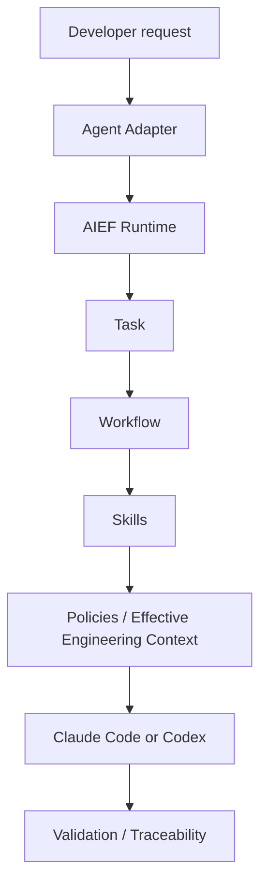

<!-- Documentation: English -->

# AI Engineering Factory

 

AI Engineering Factory (AIEF) is an agent-independent engineering layer for turning individual coding-agent usage into governed, contextualized, traceable and reproducible software engineering workflows.

**AIEF does not replace Claude Code or Codex. It defines the engineering system in which they operate.**

> The developer expresses intent; the Factory carries the engineering process.

## Project status: Alpha

AIEF is usable for pilots today, but its contracts (`apiVersion: factory.gaddigital.io/v1alpha1`) are explicit precisely because they may still evolve before a stable `v1`. Concretely, as of version `1.15.0`:

- 195 automated tests, 192 passing. The 3 known failures are diagnosed and documented in [`docs/34-release-readiness.md`](docs/34-release-readiness.md); none of them is a Core Runtime regression.
- Several organization policies (`change-policy`, `context-policy`, `external-action-policy`, `traceability-policy`, `recovery-policy`, `memory-policy`) are schema-defined but not yet enforced by any code path — see the same report.
- Evaluating the quality of code an agent produces (correctness, scope, tests, review, rework) is an intentionally unmeasured contract today, not a working feature.
- This repository does not yet carry a real open-source license (see [License](#license)).

Read [`docs/34-release-readiness.md`](docs/34-release-readiness.md) for the full, evidence-based readiness assessment before relying on AIEF for anything beyond a pilot.

## Why AIEF?

Coding agents keep getting better, but their use today is largely individual:

```text
Developer
    ↓
Agent
    ↓
ad-hoc context
ad-hoc prompts
ad-hoc workflows
ad-hoc validation
```

Left to itself, this pattern produces practices that differ by developer, context that lives only in a chat session, autonomy that is not actually bounded, and changes that are hard to reproduce or trace back to a decision.

AIEF inserts a deterministic layer between the developer's intent and the agent's semantic work:

```text
                   Organization
                       │
              Standards / Practices
                       │
                       ▼
Developer Intent → AIEF Runtime
                       │
          ┌────────────┼────────────┐
          │            │            │
       Context      Policies     Workflows
          │            │            │
          └────────────┼────────────┘
                       ▼
                Claude / Codex
                       │
                       ▼
                    Project
```

Everything that can be deterministic — state, schemas, policy resolution, workflow order, gates, tracking, workspace safety — is. Everything that requires understanding — reading code, reasoning about a change, writing and reviewing it — stays with the agent.

## What AIEF is / What AIEF is not

| AIEF is | AIEF is not |
| --- | --- |
| An engineering framework | A coding agent |
| An agent-independent Runtime | A new LLM |
| A governance and traceability layer | An autonomous engineering replacement |
| A context/workflow/policy system | An IDE |
| A shared contract Claude Code and Codex both execute | A fork or reimplementation of either agent |

## Core principles

- **Agent agnostic** — the Core has no Claude- or Codex-specific instruction anywhere.
- **Technology-agnostic Core** — no dependency on Java, Spring, Node, or any other stack in `core/`.
- **Project-owned context** — architecture, domain and conventions live in the project, not in a chat session.
- **Organization-owned engineering practices** — conventions are declared once and inherited, not copy-pasted per project.
- **Progressive context loading** — a Skill only receives the practice categories it declares needing.
- **Risk-based autonomy** — the higher the risk, the lower the autonomy the agent is authorized to use.
- **Human accountability** — protected actions require an explicit gate; the goal is maximum delegation compatible with accepted risk, not maximum autonomy.
- **Traceability by design** — every meaningful transition is attributable to a Task and an Execution.

## How it works



Explicit commands and natural language enter the same Runtime and are normalized identically — commands are shortcuts, not a separate path.

## Quick start

This is a synthesis. The full, commented procedure — including permission review and MCP activation — is [`docs/22-project-installation-guide.md`](docs/22-project-installation-guide.md).

**1. Clone the Factory** (the example organization catalog is a git submodule):

```bash
git clone --recurse-submodules <FACTORY_GIT_URL> ~/.gad/ai-engineering-factory/1.15.0
```

**2. Install the CLI**, ideally as an isolated tool with [uv](https://github.com/astral-sh/uv):

```bash
uv tool install ~/.gad/ai-engineering-factory/1.15.0
aief --help
```

A plain `pip install -e .` from the clone also works; `pyproject.toml` declares a standard `aief` console script.

**3. Point agents at this installation**:

```bash
export GAD_AI_FACTORY_HOME="$HOME/.gad/ai-engineering-factory/1.15.0"
```

**4. Install at least one adapter** (dry-run first, then execute):

```bash
aief setup-adapter claude-code --factory "$GAD_AI_FACTORY_HOME"
aief setup-adapter claude-code --factory "$GAD_AI_FACTORY_HOME" --execute
```

**5. Initialize a project** from the shipped template:

```bash
cp -R "$GAD_AI_FACTORY_HOME/templates/project/.ai" "$PROJECT_ROOT/.ai"
cp "$GAD_AI_FACTORY_HOME/templates/project/AGENTS.md" "$PROJECT_ROOT/AGENTS.md"
cp "$GAD_AI_FACTORY_HOME/templates/project/CLAUDE.md" "$PROJECT_ROOT/CLAUDE.md"
```

Edit `.ai/project.yaml`: repositories, profiles, autonomy, and which (if any) `organizationCatalogs` to inherit.

**6. Validate**:

```bash
aief validate "$PROJECT_ROOT" --factory "$GAD_AI_FACTORY_HOME"
aief doctor "$PROJECT_ROOT"
```

**7. Run a first, non-mutating request** from the agent, after restarting it so the installed skill is discovered:

```text
/analyze Analyze the current architecture without modifying any code.
```

A conformant run prints a Runtime receipt (`execution`, `workflow`, `nextPhase`, `taskLog`) — see [First workflow](#first-workflow).

## First workflow

```text
Claude Code
/analyze Analyze the current architecture without modifying any code.
```

```text
Codex
$analyze Analyze the current architecture without modifying any code.
```

Or, in either agent, the same request in natural language:

```text
Analyze the current architecture without modifying any code.
```

Commands are shortcuts; natural-language requests enter the same Runtime. Both converge on the same `analyze-task` workflow, the same Task, the same Execution, and the same Runtime-emitted event log (`.ai/runtime/tasks/<task-id>/events.jsonl`).

## Architecture

```text
core/           stack-, provider- and agent-agnostic Runtime, schemas, policies, workflows, Skills
profiles/       reusable technology/practice knowledge (Java, Spring, Node, ...)
organization/   versioned organization standards and practices, selected per project
integrations/   capability contracts mapped to providers (GitHub, GitLab, Jira, Confluence)
adapters/       thin translations of Factory semantics for Claude Code and Codex
templates/      the `.ai/` scaffold a project copies to adopt the Factory
examples/       reference projects (mono-repo and poly-repo)
aief/           the Python package implementing RuntimeService and the CLI
docs/           the architecture and operating model, numbered and cross-linked
tests/          the automated suite (195 tests)
```

- `core/` must never depend on a stack, a provider, or an agent.
- `profiles/`, `organization/`, `integrations/` and `adapters/` extend the Core; none of them may fork it.
- Project-specific truth (`context/`, `project.yaml`) lives in the project's own `.ai/` directory, never inside the Factory installation.

See [`docs/03-architecture.md`](docs/03-architecture.md) and [`docs/00-factory-reference-architecture.md`](docs/00-factory-reference-architecture.md).

## Runtime model

```text
Request
→ IntentResolution
→ Task
→ Workflow
→ Execution
→ Artifacts
→ Gates
→ Handoff
```

**Deterministic** (owned by `aief`, tested independently of any LLM call): Execution state, schema validation, policy resolution, workflow phase order, gates, tracking decisions, workspace safety.

**Agentic** (owned by Claude Code / Codex): understanding a task, analyzing code, implementing a change, semantic review.

An [Evaluation Harness](docs/33-evaluation-harness.md) verifies this separation mechanically: 12 deterministic scenarios prove Runtime conformance without any LLM call, and a second pass proves Claude Code and Codex reach an identical Runtime trajectory (same Task, same Workflow, same PolicyDecision, same Effective Engineering Context, same gates) for the same request.

## Engineering knowledge

```text
Organization
→ Profile
→ Project
→ Repository
→ Task
→ Effective Engineering Context
```

An organization declares coding conventions, architecture practices, testing and security practices once, at three enforcement levels — `mandatory` (never disabled), `default` (inherited, may be overridden where allowed), `optional` (opt-in). A project selects zero, one, or several `OrganizationCatalog`s; a Skill only receives the practice categories it declares needing. Every resolved practice carries a content hash and provenance (organization, project, repository or task), and the resulting context has a stable fingerprint so two agents — or one agent resuming — can verify they are working from the same knowledge. See [`docs/21-effective-engineering-context.md`](docs/21-effective-engineering-context.md) and [`docs/16-organization-engineering-context.md`](docs/16-organization-engineering-context.md).

Resolving several organization catalogs together is unit-tested, but the one real multi-catalog example shipped in this repository depends on a private submodule (see [Known limitations](docs/34-release-readiness.md#5-compatibility)) — treat multi-catalog inheritance as verified in isolation, not yet demonstrated end to end in this repository.

## Supported agents

| Agent | Status | Native entry point |
| --- | --- | --- |
| Claude Code | Supported | `/implement` (and `/analyze`, `/fix`, `/refactor`, `/test`, `/review`, `/document`) |
| Codex | Supported | `$implement` (same set with `$`) |

Both adapters map the same 8 Core Workflows and 14 Core Skills to the same files; the only difference is invocation syntax. No other agent is currently integrated.

### Planned / community adapters

None today. A new adapter is expected to stay thin (see [`adapters/README.md`](adapters/README.md)) and reuse `aief run` / `aief execution next` rather than reimplementing intent resolution, policy, or state.

## Profiles

```text
generic   spring   maven
java      react    node
flutter
```

A Profile supplies technology-specific knowledge (conventions, build/test commands as `shell=False` argv arrays) and may extend another Profile (for example `spring` extends `generic`). Profiles never introduce a technology dependency into `core/`. See [`docs/15-profile-runtime.md`](docs/15-profile-runtime.md).

## Integrations

```text
Core capability
→ Project provider selection
→ Factory integration manifest
→ Agent adapter (MCP configuration)
→ MCP / tool
```

| Capability | Shipped providers |
| --- | --- |
| `source-control` | GitHub, GitLab |
| `task-provider` | GitHub, GitLab, Jira |
| `knowledge-base` | Confluence |
| `continuous-integration` | GitHub, GitLab |

A project selects a capability and a provider — never a transport, URL, or token — in `.ai/project.yaml`. Integration manifests are declarative capability contracts; the actual call to a provider's API is made by the agent through its configured MCP server, never by AIEF itself. **Secrets are never stored in `.ai/project.yaml`** — `integration-lock.yaml` records resolved provider versions and content hashes, never endpoints or credentials.

## Repository structure

```text
ai-engineering-factory/
├── aief/            RuntimeService, CLI, and every deterministic module
├── core/             schemas, policies, standards, workflows, Skills
├── profiles/         technology/practice knowledge
├── organization/     versioned organization standards
├── integrations/     capability → provider contracts
├── adapters/         Claude Code and Codex adapters
├── templates/        project and organization scaffolds
├── examples/         reference mono-repo/poly-repo project
├── docs/             architecture and operating model (00–34)
└── tests/            automated suite
```

## Documentation

| Topic | Document |
| --- | --- |
| Principles | [`docs/01-principles.md`](docs/01-principles.md) |
| Architecture | [`docs/03-architecture.md`](docs/03-architecture.md) |
| Runtime model | [`docs/04-runtime-model.md`](docs/04-runtime-model.md) |
| Installation | [`docs/22-project-installation-guide.md`](docs/22-project-installation-guide.md) |
| First steps | [`docs/23-first-steps.md`](docs/23-first-steps.md) |
| Organization knowledge | [`docs/16-organization-engineering-context.md`](docs/16-organization-engineering-context.md), [`docs/24-organization-knowledge-catalog.md`](docs/24-organization-knowledge-catalog.md) |
| Agent permissions | [`docs/25-agent-permissions.md`](docs/25-agent-permissions.md) |
| Codex usage | [`docs/27-codex-usage.md`](docs/27-codex-usage.md) |
| Agent adapters and MCP | [`docs/13-agent-adapters-and-mcp.md`](docs/13-agent-adapters-and-mcp.md) |
| Runtime observability | [`docs/32-runtime-observability.md`](docs/32-runtime-observability.md) |
| Evaluation harness | [`docs/33-evaluation-harness.md`](docs/33-evaluation-harness.md) |
| Release readiness | [`docs/34-release-readiness.md`](docs/34-release-readiness.md) |

The full, numbered index (00–34) lives in [`docs/`](docs/); each document cross-links the ones it depends on.

## Security model

- **Human gates** block protected transitions (implementation, submission) until an explicit approval is recorded against the Execution.
- **Risk-based autonomy** caps what an agent may do automatically; the most restrictive applicable rule always wins.
- **Workspace safety** blocks mutation on a dirty repository, a wrong base branch, or unresolved poly-repo drift, and refuses `git` force-push, hard reset, clean, or branch deletion outright.
- **Secrets** are never stored in `.ai/project.yaml` or in generated adapter configuration; only capability→provider selections are.
- **MCP configuration** grants connectivity, not authorization — policy and gates are checked again before every external side effect.

**Gap:** this repository does not yet have a `SECURITY.md`. Until one exists, report a suspected vulnerability directly to the maintainers rather than through a public issue.

## Contributing

Contributions are welcome.

**Gap:** this repository does not yet have a `CONTRIBUTING.md` or a `CODE_OF_CONDUCT.md`. Until they exist, open an issue to discuss a change before submitting a pull request, and expect the review to check the non-negotiable invariants above (Core stays agent/stack/provider-agnostic, no duplicated abstractions, deterministic where determinism is possible).

## Roadmap

**Available today** — see [`docs/34-release-readiness.md`](docs/34-release-readiness.md) for the full, evidence-based list: deterministic Runtime (intake, workflow, gates, tracking, workspace safety), Effective Engineering Context resolution, Claude Code / Codex parity verified by the Evaluation Harness, local structured event log with optional OpenTelemetry export.

**In progress**: enforcement of the remaining organization policies (`change-policy`, `context-policy`, `external-action-policy`, `traceability-policy`, `recovery-policy`, `memory-policy`), organization-catalog deprecation and content-addressed locking.

**Exploration**: Level 3 Engineering Outcome measurement (correctness, scope respect, test quality, review findings, rework, policy violations) — the contract exists ([`core/schemas/engineering-outcome.schema.json`](core/schemas/engineering-outcome.schema.json)); no measurement is implemented.

None of the above is available today beyond what is explicitly listed as such.

## License

This repository does not currently carry a public open-source license. `LICENSE` is an internal placeholder pending an organization-approved license choice.

```text
OPEN_SOURCE_BLOCKER: LICENSE missing
```

Do not treat this repository as licensed for reuse, and do not publish it externally, until this is resolved. See [`OPEN_SOURCE_READINESS.md`](OPEN_SOURCE_READINESS.md).
