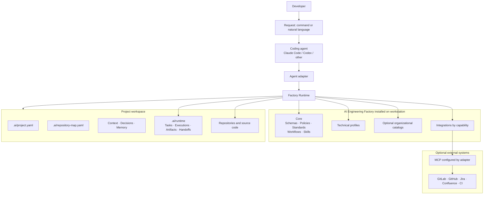
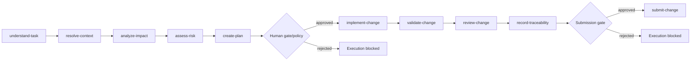
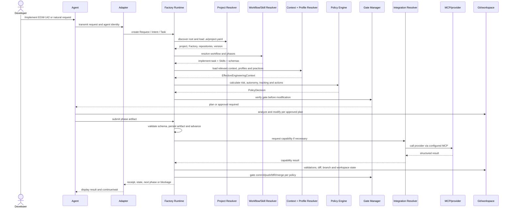
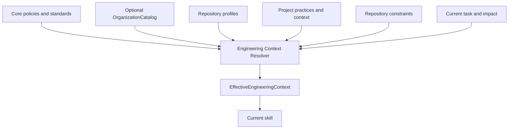
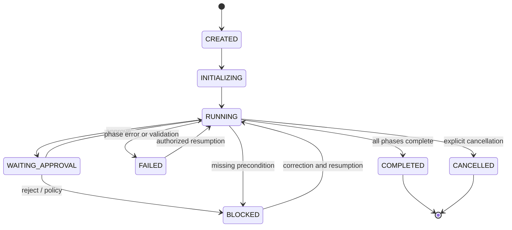
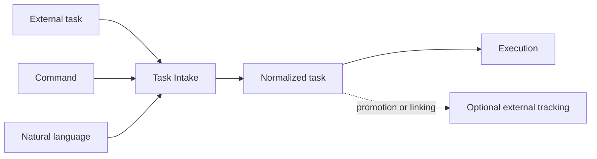
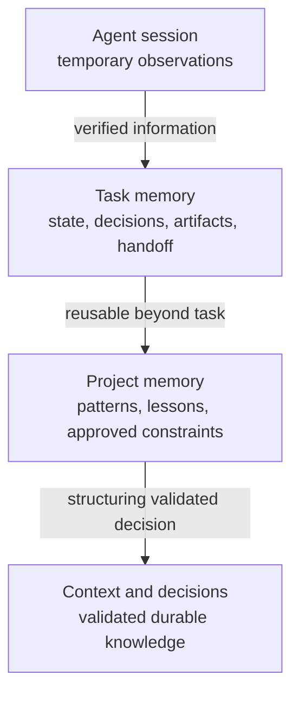
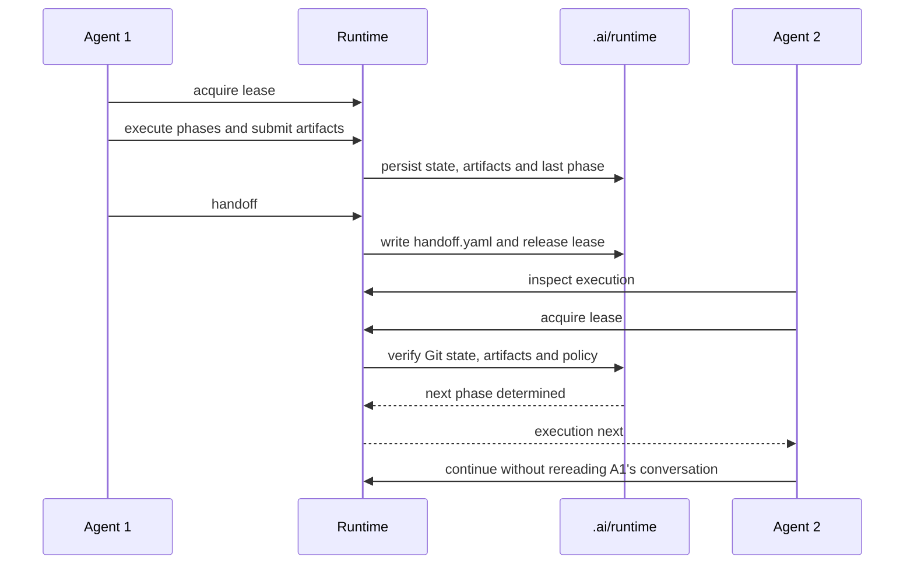

# AI Engineering Factory — Consolidated Reference

This document is the Factory overview: its purpose,
how it functions between the Core and a project, its solution architecture and its
executable technical architecture.

## 1. Product Purpose

The AI Engineering Factory industrializes the use of coding agents while
preserving engineering practices, project context, traceability and human
control.

The desired progression is:

```text
Augmented developer
        → Augmented team
        → Augmented delivery
        → Augmented engineering organization
```

The Factory is neither an agent, nor a technical stack, nor a ticket
provider. It provides a common process that Claude Code, Codex or another
agent can execute.

## 2. Responsibility Model

| Layer | Responsibility | Example content |
| --- | --- | --- |
| Core | Define how to work | schemas, policies, standards, workflows, skills |
| Organization | Publish reusable practices | standards, practices, versioned catalogs |
| Profile | Describe a technology or repository type | Java, Maven, Flutter, Node |
| Project | Describe where and under what constraints to work | `.ai/project.yaml`, architecture, domain |
| Integration | Provide an external capability | task-provider, source-control, CI |
| Adapter | Translate the Runtime to an agent | Claude Code, Codex |
| MCP/provider | Execute the call to an external system | GitLab, GitHub, Jira, Confluence |

Dependency rule: The Core depends only on its own contracts. Lower layers
can specialize or constrain the Core, but cannot impose an agent, stack or provider on it.

## 3. Solution Architecture



The project does not copy the Core. It selects a Factory version and
provides only its context and bindings.

### Reading the Flow

This architecture separates responsibilities:

```text
Common process        → Core
Technical specifics → Profiles
Project config      → .ai/project.yaml
Agent used          → Adapter
External system     → Provider/MCP
Execution state     → .ai/runtime/
```

The developer formulates a request, for example `$implement Feature 2.1`.
The coding agent (Codex, Claude Code or another agent) transmits it to its
adapter. The adapter translates the agent's capabilities to the common protocol,
then the Runtime orchestrates the task: normalization, phases, policies,
validations, gates and traceability.

The Core contains reusable rules: schemas, policies, workflows and
skills. Profiles add rules specific to a technology like
Java, Maven or Flutter. The project provides its local context with
`.ai/project.yaml`, `.ai/repository-map.yaml`, decisions, memory and
source repositories. The `.ai/runtime/` folder preserves the generated execution state and remains local.

External systems like GitLab, GitHub, Jira or Confluence are called
only when a capability requires it. The Runtime uses an abstract contract, for example `source-control → submit-change` or
`task-provider → search-task`, then the adapter invokes the real provider's MCP:

```text
Runtime → Integration → MCP → GitLab/GitHub/Jira/Confluence
```

Thus the workflow remains identical regardless of the agent, technology or
provider selected by the project.

Submission is also controlled by a proof chain: acceptance criteria, persisted validations, coverage matrix and independent review. An incomplete submission is refused by the Runtime. Validations can be replayed from the recorded plan to verify that they still match the same commit.

The detailed procedure is described in [29 — Evidence Chain and Validation Replay](29-evidence-chain-and-replay.md).

## 4. Core Content

```text
core/
├── schemas/       # Machine-readable contracts and artifacts
├── standards/     # Methods and quality criteria
├── policies/      # Authorizations, risks, gates, traceability
├── workflows/     # Ordered orchestration of phases
└── skills/        # Agentic capabilities with contract and output schema
```

A workflow defines **what to do and in what order**. A Skill defines a
capability and its method. A Policy decides what is allowed. A Profile
explains how a validation or convention applies to a technology.

Example of `implement-task` workflow:



Each transition transmits a structured artifact validated by schema, never
implicit free text.

## 5. Consumer Project Structure

```text
project/
├── AGENTS.md                 # Common agent bootstrap
├── CLAUDE.md                 # Claude Code bridge/bootstrap
├── .mcp.json                 # Claude MCP project, if authorized
├── .codex/config.toml        # Codex MCP and permissions, if authorized
└── .ai/
    ├── project.yaml          # Identity, Factory, profiles, providers
    ├── repository-map.yaml   # Topology and poly-repo dependencies
    ├── context/
    │   ├── project.md
    │   ├── architecture.md
    │   ├── domain.md
    │   └── conventions.md
    ├── decisions/            # Validated durable decisions
    ├── memory/               # Approved project knowledge
    ├── integration-lock.yaml # Versioned resolution without secrets
    └── runtime/
        ├── tasks/            # Task state and handoff
        └── executions/       # Phases, artifacts and decisions
```

The `emmany-coming-soon` folder, an experimental repository or any other
undeclared directory remains out of scope. The absence of an entry in
`repositories` does not grant the Runtime the right to modify it.

## 6. Actual Execution Cycle



The Runtime preserves state in `.ai/runtime/`. A new session or
another agent rereads this state and does not depend on conversation history.

The project versions its durable truth, notably `.ai/project.yaml`, the repository map, approved context, decisions, validated memory and
integration lock. `.ai/runtime/` remains ignored because it contains
local, generated execution state.

When a merge produces a conflict in durable `.ai/` files, the
resolution is reviewed like a code modification: keep both
versions until decision, verify repositories, providers, branches
and resulting policies, then resume project validation. A conflict
in `.ai/runtime/` should normally not occur since it is ignored.

## 7. Deterministic Runtime and Agentic Reasoning

| Responsibility | Nature | Authority |
| --- | --- | --- |
| Discover workspace | Deterministic | Runtime |
| Validate YAML/JSON Schema | Deterministic | Runtime |
| Resolve Factory, workflow, Skill and version | Deterministic | Runtime |
| Understand business need | Agentic | Agent |
| Analyze code impact | Agentic | Agent, structured artifact |
| Calculate risk/autonomy/tracking | Deterministic | Policy Engine |
| Propose a plan | Agentic | Agent, possible gate |
| Execute a profile command | Deterministic | Runtime, after authorization |
| Modify code | Agentic | Agent, approved scope |
| Verify diff and tests | Hybrid | Agent + Runtime |
| Persist state, artifacts and handoff | Deterministic | Runtime |
| Call GitLab/GitHub/Jira/Confluence | Deterministic | Adapter + Integration + MCP |

Thus the Runtime does not become a new agent. It guarantees
reproducibility, security and governance around the agent's reasoning capabilities.

## 8. Inheritance of Engineering Practices

The effective context is calculated by level:



`mandatory` practices cannot be overridden. `default` practices
can be specialized when their manifest allows it. `optional` practices
must be explicitly activated. A project can select no organizational catalog
and keep only its local conventions.

## 9. External Capabilities and MCP

The Core requests a capability, never a concrete MCP tool:

```text
Skill → task-provider
      → provider declared in .ai/project.yaml
      → Integration catalog Factory
      → Adapter Claude/Codex
      → MCP configured locally
      → external system
```

The project declares, for example:

```yaml
integrations:
  task-provider: {provider: example-provider}
  source-control: {provider: example-provider}
```

URLs, transports and secrets remain outside the project or in an authorized managed configuration. The Runtime fails explicitly if the provider, capability,
MCP or authentication are unavailable; it does not silently fall back.

## 10. States and Resumption



A resumption verifies execution identity, current phase, already-validated artifacts, any lease and workspace Git state. A divergence or
unattributed local modification blocks the action rather than overwriting it.

## 11. Portable Commands

`aief` is the deterministic CLI common to adapters. Commands are
portable between projects and agents; only native entry point and
presentation change:

| Need | Claude Code | Codex | Portable CLI |
| --- | --- | --- | --- |
| Implement | `/implement ...` | `$implement ...` | `aief run ... --intent implement` |
| Fix | `/fix ...` | `$fix ...` | `aief run ... --intent fix` |
| Refactor | `/refactor ...` | `$refactor ...` | `aief run ... --intent refactor` |
| Test | `/test ...` | `$test ...` | `aief run ... --intent test` |
| Analyze | `/analyze ...` | `$analyze ...` | `aief run ... --intent analyze` |
| Review | `/review ...` | `$review ...` | `aief run ... --intent review` |
| Document | `/document ...` | `$document ...` | `aief run ... --intent document` |

Agent-independent example:

```bash
aief run "Implement the filtering feature" \
  --agent codex \
  --intent implement \
  --expect-workflow implement-task \
  --project . \
  --factory "$FACTORY_HOME"
```

Diagnosis and installation commands:

```bash
aief validate . --factory "$FACTORY_HOME"
aief doctor .
aief inspect . --json
aief init <project-directory>
aief resolve <decision-file> --json
aief setup-adapter codex --factory "$FACTORY_HOME"
aief setup-adapter claude-code --factory "$FACTORY_HOME"
```

Integration and context commands:

```bash
aief integrations lock . --factory "$FACTORY_HOME"
aief integrations doctor . --factory "$FACTORY_HOME"
aief integrations sync . --factory "$FACTORY_HOME"
aief engineering-context <repository-id> <skill-id> \
  --project . --factory "$FACTORY_HOME" --json
```

The Runtime does not ask the agent to reimplement these operations. The
adapters invoke them with explicit paths, project identifier and
resolved Factory version.

## 12. Tasks: Unit of Work and Traceability

A `Task` is the normalized representation of a request. It can come
from an external ticket, a command or natural language:



A local Task can remain local for a small change, or be linked to a
provider when tracking policy recommends or requires it. An external Task
always preserves a local Runtime identity and an external canonical reference when linked.

Task management commands:

```bash
aief intake "Fix status mapping" --project . --factory "$FACTORY_HOME"
aief task inspect <task-id> --project . --factory "$FACTORY_HOME"
aief task log <task-id> --project . --factory "$FACTORY_HOME"
aief task tracking <task-id> --project . --factory "$FACTORY_HOME"
aief task assess-tracking <task-id> --impact impact.yaml \
  --project . --factory "$FACTORY_HOME"
aief task resolve-provider <task-id> --project . --factory "$FACTORY_HOME"
```

For an external provider, the controlled sequence is: search for duplicates,
propose, human gate, create or link, then resume workflow:

```bash
aief task search-external <task-id> --project . --factory "$FACTORY_HOME"
aief task complete-search <task-id> --result matches.yaml \
  --project . --factory "$FACTORY_HOME"
aief task link <task-id> <external-reference> \
  --project . --factory "$FACTORY_HOME"
aief task propose-external <task-id> --proposal proposal.yaml \
  --project . --factory "$FACTORY_HOME"
aief task create-external <task-id> --project . --factory "$FACTORY_HOME"
```

A creation or linking is never a silent fallback: provider,
capability, authentication, policy and gate must all be available.

## 13. How Memory Functions

The Factory has no implicit global memory. It distinguishes four
levels:



| Level | Typical location | Duration | Source of truth |
| --- | --- | --- | --- |
| Session | Claude/Codex context | session | none |
| Task | `.ai/runtime/tasks/<task-id>/` | task duration | current task |
| Execution | `.ai/runtime/executions/<execution-id>/` | Runtime retention | execution state |
| Project memory | `.ai/memory/` | versioned | approved knowledge |
| Context/decisions | `.ai/context/`, `.ai/decisions/` | durable | validated project truth |

Promotion is controlled: a session observation first becomes a
task artifact, then possibly a `MemoryCandidate`. It is written
to project memory only after explicit validation. The agent's conversation is
never used to resume a task or establish a decision.

## 14. Multi-Agent Resumption and Handoff

A resumption always follows persistent state, never chat context:



Resumption commands:

```bash
aief execution inspect <execution-id> --project . --factory "$FACTORY_HOME"
aief execution next <execution-id> --project . --factory "$FACTORY_HOME"
aief execution handoff <execution-id> --owner agent:session \
  --project . --factory "$FACTORY_HOME"
aief execution lease acquire <execution-id> --owner agent:session --ttl 300
aief execution lease renew <execution-id> --owner agent:session --ttl 300
aief execution lease status <execution-id>
aief execution lease release <execution-id> --owner agent:session
```

Before resuming, the Runtime verifies:

- that the Execution exists and is not cancelled or completed;
- that previous artifacts respect their schemas;
- that workflow and Factory version are identical;
- that the lease is free, expired or held by the current agent;
- that Git workspace matches the recorded snapshot;
- that new information does not require policy reclassification.

The same operation replayed with the same `operationId` returns its
persisted result without producing a duplicate. The same identifier with different content
is refused.

## 15. Operational Summary

```text
Developer intent
    → Normalized task
    → Versioned workflow
    → Effective context/profile
    → PolicyDecision
    → Plan and gate
    → Controlled agentic modification
    → Deterministic validation
    → Review
    → Traceability/handoff
    → Commit, MR or merge per authorization
```

To install a project, see [22 — Project Installation Guide](22-project-installation-guide.md).
For runtime commands and resumption, see [14 — Universal Factory Runtime](14-universal-runtime.md).
For adapters and MCP, see [13 — Agent Adapters and MCP](13-agent-adapters-and-mcp.md).
