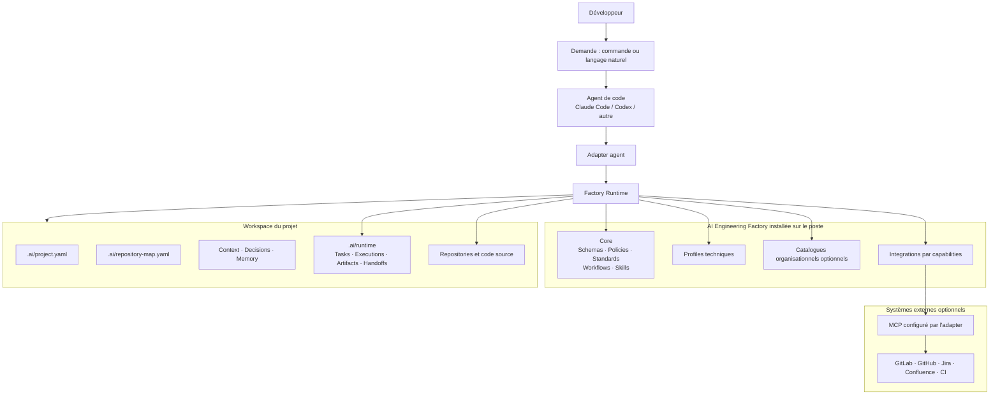
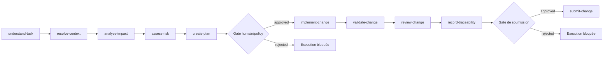
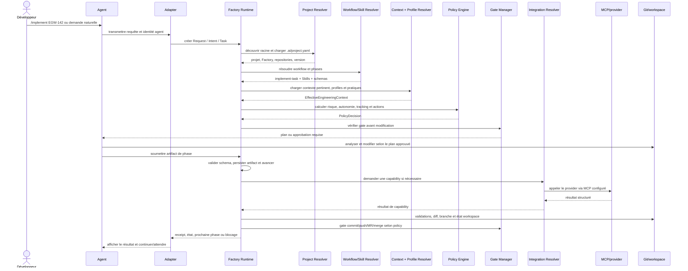
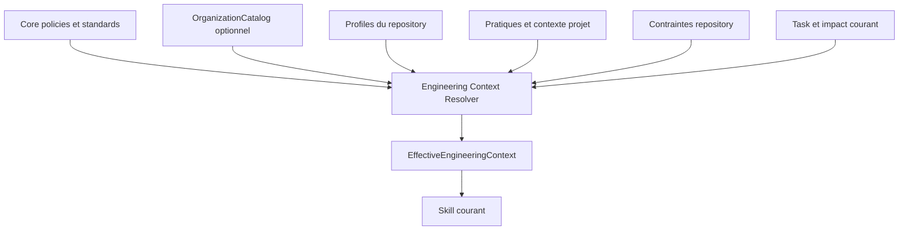
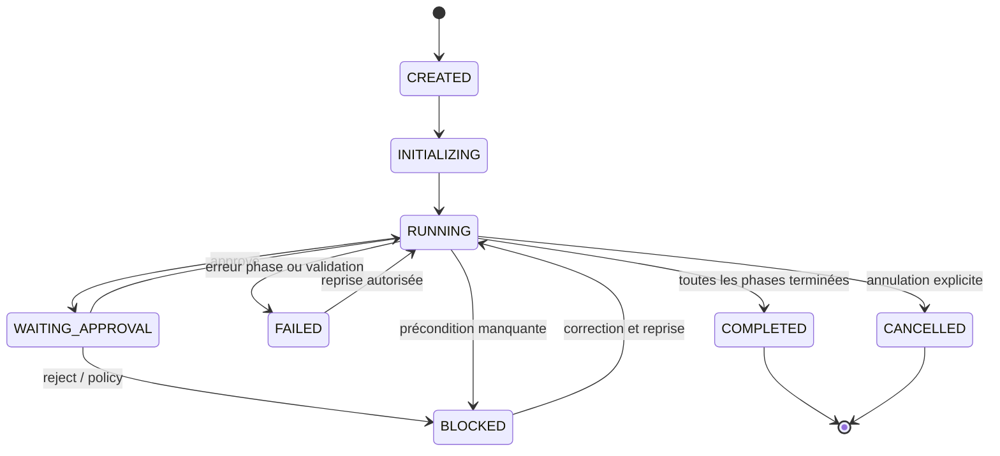
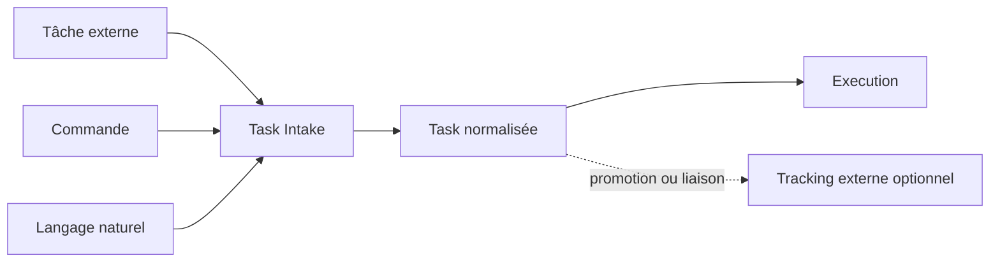
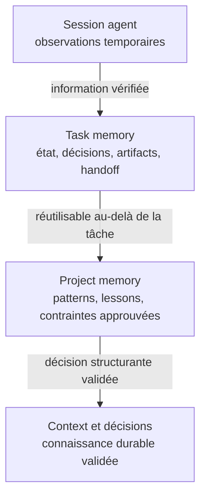
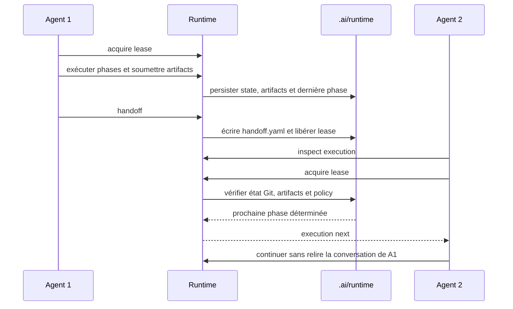

# AI Engineering Factory — Référence consolidée

Ce document est la vue d'ensemble de la Factory : son objectif, son
fonctionnement entre le Core et un projet, son architecture de solution et son
architecture technique exécutable.

## 1. Finalité du produit

L'AI Engineering Factory industrialise l'utilisation d'agents de code tout en
conservant les pratiques d'ingénierie, le contexte projet, la traçabilité et le
contrôle humain.

La progression recherchée est :

```text
Développeur augmenté
        → Équipe augmentée
        → Delivery augmenté
        → Organisation d'ingénierie augmentée
```

La Factory n'est ni un agent, ni une stack technique, ni un fournisseur de
tickets. Elle fournit un processus commun que Claude Code, Codex ou un autre
agent peut exécuter.

## 2. Modèle de responsabilité

| Couche | Responsabilité | Exemples de contenu |
| --- | --- | --- |
| Core | Définir comment travailler | schemas, policies, standards, workflows, skills |
| Organization | Publier des pratiques réutilisables | standards, practices, catalogues versionnés |
| Profile | Décrire une technologie ou un type de repository | Java, Maven, Flutter, Node |
| Project | Décrire où et sous quelles contraintes travailler | `.ai/project.yaml`, architecture, domaine |
| Integration | Fournir une capability externe | task-provider, source-control, CI |
| Adapter | Traduire le Runtime vers un agent | Claude Code, Codex |
| MCP/provider | Exécuter l'appel vers un système externe | GitLab, GitHub, Jira, Confluence |

Règle de dépendance : le Core dépend uniquement de ses contrats. Les couches
inférieures peuvent spécialiser ou restreindre le Core, mais ne peuvent pas lui
imposer un agent, une stack ou un provider.

## 3. Architecture de solution



Le projet ne copie pas le Core. Il sélectionne une version de Factory et
fournit uniquement son contexte et ses bindings.

## 4. Contenu du Core

```text
core/
├── schemas/       # Contrats machine-readable et artifacts
├── standards/     # Méthodes et critères de qualité
├── policies/      # Autorisations, risques, gates, traçabilité
├── workflows/     # Orchestration ordonnée des phases
└── skills/        # Capacités agentiques avec contrat et output schema
```

Un workflow définit **quoi faire et dans quel ordre**. Un Skill définit une
capacité et sa méthode. Une Policy décide ce qui est autorisé. Un Profile
explique comment une validation ou une convention s'applique à une technologie.

Exemple de workflow `implement-task` :



Chaque transition transmet un artifact structuré et validé par schema, jamais
un texte libre implicite.

## 5. Structure d'un projet consommateur

```text
project/
├── AGENTS.md                 # Bootstrap commun des agents
├── CLAUDE.md                 # Pont/bootstrap Claude Code
├── .mcp.json                 # MCP projet Claude, si autorisé
├── .codex/config.toml        # MCP et permissions Codex, si autorisé
└── .ai/
    ├── project.yaml          # Identité, Factory, profiles, providers
    ├── repository-map.yaml   # Topologie et dépendances poly-repo
    ├── context/
    │   ├── project.md
    │   ├── architecture.md
    │   ├── domain.md
    │   └── conventions.md
    ├── decisions/            # Décisions durables validées
    ├── memory/               # Connaissance projet approuvée
    ├── integration-lock.yaml # Résolution versionnée sans secret
    └── runtime/
        ├── tasks/            # État Task et handoff
        └── executions/       # Phases, artifacts et décisions
```

Le dossier `emmany-coming-soon`, un repository expérimental ou tout autre
répertoire non déclaré reste hors périmètre. L'absence d'une entrée dans
`repositories` ne donne pas le droit au Runtime de le modifier.

## 6. Cycle d'exécution réel



Le Runtime conserve l'état dans `.ai/runtime/`. Une nouvelle session ou un
autre agent relit cet état et ne dépend pas de l'historique conversationnel.

## 7. Runtime déterministe et raisonnement agentique

| Responsabilité | Nature | Autorité |
| --- | --- | --- |
| Découvrir le workspace | Déterministe | Runtime |
| Valider YAML/JSON Schema | Déterministe | Runtime |
| Résoudre Factory, workflow, Skill et version | Déterministe | Runtime |
| Comprendre le besoin métier | Agentique | Agent |
| Analyser l'impact du code | Agentique | Agent, artifact structuré |
| Calculer risque/autonomie/tracking | Déterministe | Policy Engine |
| Proposer un plan | Agentique | Agent, gate éventuel |
| Exécuter une commande de profil | Déterministe | Runtime, après autorisation |
| Modifier le code | Agentique | Agent, scope approuvé |
| Vérifier le diff et les tests | Hybride | Agent + Runtime |
| Persister état, artifacts et handoff | Déterministe | Runtime |
| Appeler GitLab/GitHub/Jira/Confluence | Déterministe | Adapter + Integration + MCP |

Le Runtime ne devient donc pas un nouvel agent. Il garantit la reproductibilité,
la sécurité et la gouvernance autour des capacités de raisonnement de l'agent.

## 8. Héritage des pratiques d'ingénierie

Le contexte effectif est calculé par niveau :



Les pratiques `mandatory` ne sont pas surchargeables. Les pratiques `default`
peuvent être spécialisées lorsque leur manifeste l'autorise. Les pratiques
`optional` doivent être activées explicitement. Un projet peut ne sélectionner
aucun catalogue organisationnel et garder uniquement ses conventions locales.

## 9. Capabilities externes et MCP

Le Core demande une capability, jamais un outil MCP concret :

```text
Skill → task-provider
      → provider déclaré dans .ai/project.yaml
      → Integration catalog Factory
      → Adapter Claude/Codex
      → MCP configuré localement
      → système externe
```

Le projet déclare par exemple :

```yaml
integrations:
  task-provider: {provider: example-provider}
  source-control: {provider: example-provider}
```

Les URLs, transports et secrets restent hors du projet ou dans une configuration
gérée autorisée. Le Runtime échoue explicitement si le provider, la capability,
le MCP ou l'authentification sont indisponibles ; il ne fait pas de fallback
silencieux.

## 10. États et reprise



Une reprise vérifie l'identité de l'exécution, la phase courante, les artifacts
déjà validés, le lease éventuel et l'état Git du workspace. Une divergence ou
une modification locale non attribuée à l'exécution bloque l'action plutôt que
de l'écraser.

## 11. Commandes portables

`aief` est la CLI déterministe commune aux adapters. Les commandes sont
portables entre les projets et les agents ; seuls le point d'entrée natif et la
présentation changent :

| Besoin | Claude Code | Codex | CLI portable |
| --- | --- | --- | --- |
| Implémenter | `/implement ...` | `$implement ...` | `aief run ... --intent implement` |
| Corriger | `/fix ...` | `$fix ...` | `aief run ... --intent fix` |
| Refactorer | `/refactor ...` | `$refactor ...` | `aief run ... --intent refactor` |
| Tester | `/test ...` | `$test ...` | `aief run ... --intent test` |
| Analyser | `/analyze ...` | `$analyze ...` | `aief run ... --intent analyze` |
| Reviewer | `/review ...` | `$review ...` | `aief run ... --intent review` |
| Documenter | `/document ...` | `$document ...` | `aief run ... --intent document` |

Exemple indépendant de l'agent :

```bash
aief run "Implémente la fonctionnalité de filtrage" \
  --agent codex \
  --intent implement \
  --expect-workflow implement-task \
  --project . \
  --factory "$FACTORY_HOME"
```

Commandes de diagnostic et d'installation :

```bash
aief validate . --factory "$FACTORY_HOME"
aief doctor .
aief inspect . --json
aief init <project-directory>
aief resolve <decision-file> --json
aief setup-adapter codex --factory "$FACTORY_HOME"
aief setup-adapter claude-code --factory "$FACTORY_HOME"
```

Commandes d'intégration et de contexte :

```bash
aief integrations lock . --factory "$FACTORY_HOME"
aief integrations doctor . --factory "$FACTORY_HOME"
aief integrations sync . --factory "$FACTORY_HOME"
aief engineering-context <repository-id> <skill-id> \
  --project . --factory "$FACTORY_HOME" --json
```

Le Runtime ne demande pas à l'agent de réimplémenter ces opérations. Les
adapters les invoquent avec des chemins explicites, l'identifiant du projet et
la version de Factory résolue.

## 12. Tasks : unité de travail et traçabilité

Une `Task` est la représentation normalisée d'une demande. Elle peut provenir
d'un ticket externe, d'une commande ou du langage naturel :



Une Task locale peut rester locale pour un petit changement, ou être liée à un
provider lorsque la policy de tracking le recommande ou l'exige. Une Task
externe conserve toujours une identité Runtime locale et une référence
canonique externe lorsqu'elle est liée.

Commandes de gestion des Tasks :

```bash
aief intake "Corrige le mapping des statuts" --project . --factory "$FACTORY_HOME"
aief task inspect <task-id> --project . --factory "$FACTORY_HOME"
aief task log <task-id> --project . --factory "$FACTORY_HOME"
aief task tracking <task-id> --project . --factory "$FACTORY_HOME"
aief task assess-tracking <task-id> --impact impact.yaml \
  --project . --factory "$FACTORY_HOME"
aief task resolve-provider <task-id> --project . --factory "$FACTORY_HOME"
```

Pour un provider externe, la séquence contrôlée est : recherche de doublon,
proposition, gate humain, création ou liaison, puis reprise du workflow :

```bash
aief task search-external <task-id> --project . --factory "$FACTORY_HOME"
aief task complete-search <task-id> --result matches.yaml \
  --project . --factory "$FACTORY_HOME"
aief task link <task-id> <external-reference> \
  --project . --factory "$FACTORY_HOME"
aief task propose-external <task-id> --proposal proposal.yaml \
  --project . --factory "$FACTORY_HOME"
aief task create-external <task-id> --project . --factory "$FACTORY_HOME"
```

Une création ou une liaison n'est jamais un fallback silencieux : provider,
capability, authentification, policy et gate doivent tous être disponibles.

## 13. Fonctionnement de la mémoire

La Factory ne possède pas une mémoire globale implicite. Elle distingue quatre
niveaux :



| Niveau | Localisation typique | Durée | Source de vérité |
| --- | --- | --- | --- |
| Session | contexte de Claude/Codex | session | aucune |
| Task | `.ai/runtime/tasks/<task-id>/` | durée de la tâche | tâche courante |
| Execution | `.ai/runtime/executions/<execution-id>/` | rétention Runtime | état de l'exécution |
| Project memory | `.ai/memory/` | versionnée | connaissance approuvée |
| Context/decisions | `.ai/context/`, `.ai/decisions/` | durable | vérité projet validée |

La promotion est contrôlée : une observation de session devient d'abord un
artifact de tâche, puis éventuellement un `MemoryCandidate`. Elle n'est écrite
dans la mémoire projet qu'après validation explicite. La conversation de
l'agent n'est jamais utilisée pour reprendre une tâche ou établir une décision.

## 14. Reprise et handoff multi-agent

Une reprise suit toujours l'état persistant, jamais le contexte de chat :



Commandes de reprise :

```bash
aief execution inspect <execution-id> --project . --factory "$FACTORY_HOME"
aief execution next <execution-id> --project . --factory "$FACTORY_HOME"
aief execution handoff <execution-id> --owner agent:session \
  --project . --factory "$FACTORY_HOME"
aief execution lease acquire <execution-id> --owner agent:session --ttl 300
aief execution lease renew <execution-id> --owner agent:session --ttl 300
aief execution lease status <execution-id>
aief execution lease release <execution-id> --owner agent:session
```

Avant de reprendre, le Runtime vérifie :

- que l'Execution existe et n'est pas annulée ou terminée ;
- que les artifacts précédents respectent leurs schemas ;
- que le workflow et la version de Factory sont identiques ;
- que le lease est libre, expiré ou détenu par l'agent courant ;
- que le workspace Git correspond au snapshot enregistré ;
- que les nouvelles informations n'imposent pas une reclassification de policy.

Une même opération rejouée avec le même `operationId` renvoie son résultat
persisté sans produire de doublon. Le même identifiant avec un contenu différent
est refusé.

## 15. Résumé opérationnel

```text
Intention développeur
    → Task normalisée
    → Workflow versionné
    → Context/Profile effectifs
    → PolicyDecision
    → Plan et gate
    → Modification agentique contrôlée
    → Validation déterministe
    → Review
    → Traceability/Handoff
    → Commit, MR ou merge selon autorisation
```

Pour installer un projet, consulter [22 — Project installation guide](22-project-installation-guide.md).
Pour les commandes et la reprise Runtime, consulter [14 — Universal Factory Runtime](14-universal-runtime.md).
Pour les adapters et MCP, consulter [13 — Agent adapters and MCP](13-agent-adapters-and-mcp.md).
