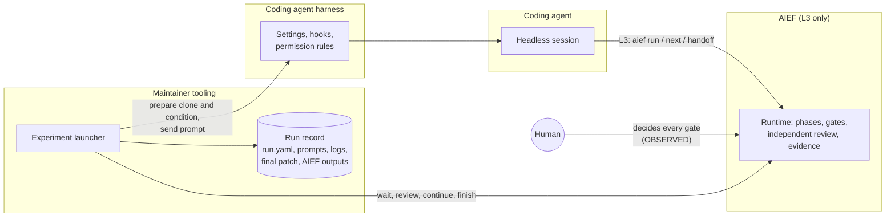

# 33 — Evaluation Harness

AIEF does not compare models before knowing that it respects its own
contracts. The harness (`aief/scenarios.py`) checks this at three separate
levels. It is not a benchmark platform: twelve fixed scenarios, no
dashboard, no persistent state beyond what a pytest test already writes in
`tmp_path`.

## Level 1 — Runtime Conformance (100% deterministic)

Each scenario is a `Given/When/Then` run directly against the Runtime
(`RuntimeService`, `resolve_engineering_context`, `evaluate_runtime_policy`,
`resolve_task_provider`), never through an LLM agent. Twelve scenarios
cover: `simple-feature`, `natural-language-bug`,
`ambiguous-request`, `multi-repo-change`, `high-risk-change`,
`dirty-workspace`, `missing-provider`, `tracking-required`, `human-gate`,
`policy-conflict`, `organization-practice-override`,
`handoff-claude-to-codex`.

```python
from pathlib import Path
from aief.scenarios import run_scenario

result = run_scenario("high-risk-change", Path("."), Path("/tmp/scenario-run"))
```

## Level 2 — Adapter Conformance

It does not compare the quality of the code produced. It checks that the
Runtime treats `claude-code` and `codex` strictly identically: same
normalized Task, same compiled Workflow, same policy decision, same effective
engineering context, same gates passed. Technically it is **not** a second
scenario catalog: it is the same Level 1 scenario, replayed once per agent,
whose results are diffed.

```python
from aief.scenarios import run_adapter_conformance

result = run_adapter_conformance("human-gate", Path("."), Path("/tmp/scenario-run"))
```

Scenarios whose code path never receives an agent identity
(`multi-repo-change`, `high-risk-change`, `policy-conflict`,
`organization-practice-override`, `handoff-claude-to-codex`) are marked
`agent_parametrized=False`: their cross-agent conformance is guaranteed by
construction (no agent-dependent branch exists in that code), and Level 2
records it instead of replaying a pointless diff.

## Level 3 — Engineering Outcome (contract only)

`core/schemas/engineering-outcome.schema.json` fixes the six dimensions to
evaluate later — correctness, scopeRespect, testQuality, reviewFindings,
rework, policyViolations — each `not_evaluated` until a real agent execution
has produced code to judge. `pending_engineering_outcome(...)` produces a
document valid against this schema, without any measurement: the actual
evaluation of code quality stays outside AIEF's scope (it belongs to the
agent and, later, to a separate human or LLM judge).

## Experimental conditions L0--L3

`evaluation_run(...)` produces an `EvaluationRun` contract for the four
experimental conditions: L0 raw agent, L1 contextualized agent, L2 structured
engineering, and L3 governed control plane. Each descriptor fixes the task,
repository, starting commit, agent, acceptance criteria, environment and repeat
number. The harness records the condition; it does not claim to execute or
judge an LLM experiment.

Running the units is the job of a separate maintainer tool, described in
[Running experimental units](#running-experimental-units). The Runtime itself
only ever runs L3.

## Running experimental units

`tools/experiment/aief_experiment.py` runs one experimental unit: one coding
agent execution of one frozen task under one condition, for one repeat. It is
maintainer tooling outside the Runtime; its full reference is
`tools/experiment/README.md`.

| Condition | What the agent receives | How the launcher prepares it |
|---|---|---|
| L0 raw agent | the request | isolated clone at the starting commit; `.ai/`, `.claude/`, `.codex/`, `AGENTS.md` and `CLAUDE.md` removed in a setup commit |
| L1 contextualized agent | L0 plus a project context | the frozen context file as `AGENTS.md` (and `CLAUDE.md` importing it) |
| L2 structured engineering | L1 plus plan and verification | the frozen plan and verification specification under `.experiment/` |
| L3 governed control plane | the AIEF native command | the project unchanged; the same frozen plan and verification bound with `--bound-plan`/`--bound-verification` and their expected SHA-256 |



Rules the launcher holds:

- **Frozen treatments.** Context, plan and verification files are checked
  against their frozen SHA-256 before a run; a modified file is refused. L1
  and L2 receive the same context, L2 and L3 the same plan and verification.
  In L3 the frozen plan and verification hashes are required and passed as
  `--expect-*-sha256`, so the plan gate compares the bound files with the
  freeze rather than with themselves.
  The prompt templates are hashed and recorded with every run.
- **Isolation.** In L0–L2, Codex runs with an isolated `HOME` and without user
  configuration or rules; Claude Code runs without skills, commands or user
  settings, and with an isolated `HOME` when the operator supplies a
  long-lived token. Settings and hooks managed by the account's organization
  still apply, and the run records it.
- **No decision.** The launcher never approves, rejects or waives. In L3 the
  human decides each gate from their own terminal, recorded as `OBSERVED`
  ([34 — Human Approval](34-human-approval.md)). While a gate or the
  integration waits, the launcher polls through `aief execution gate-check`,
  which applies a passed response limit, so an undecided gate expires instead
  of keeping the run waiting. A cancelled or blocked execution, and an
  integration rejected or expired, are final states of the run, recorded as
  the Runtime left them.
- **No judgment.** The launcher records the final workspace patch, the branch
  patches and, in L3, the execution, evidence bundle, payload ledger, gate
  check and metrics. The task oracle and the analysis run separately on those
  records.
- **Observed values only.** Agent version and Factory commit are read at run
  time; the model identifier comes from the run descriptor and is otherwise
  `UNAVAILABLE`. Step durations are wall-clock observations of the agent
  process; tokens and cost are not recorded.

## Fixtures

A single reusable minimal project (`templates/project`, through
`_seed_project`), with targeted overrides (autonomy, repositories,
`taskTracking`) per scenario. Multi-repository scenarios reuse the existing
`examples/sample-project` rather than introducing a second fixture. Each
scenario is reproducible: same inputs, same outputs, on any machine (`tests/test_scenarios.py::test_scenarios_are_reproducible_across_independent_runs`).

## Reporting

`format_report(results)` produces a plain text table, not a dashboard:

```text
Scenario           Expected                                            Observed                              Status  Evidence
-----------------  --------------------------------------------------  ------------------------------------  ------  ------------------------------------------
ambiguous-request  Given an ambiguous request ...; then analyze-task    {'workflow': 'analyze-task', ...}      PASS    level1:ambiguous-request:agent=claude-code
dirty-workspace    Given a dirty local workspace ...; then blocked      {'status': 'blocked', ...}             PASS    level1:dirty-workspace:agent=claude-code
high-risk-change   Given HIGH risk ...; then autonomy <= L2             {'effectiveRisk': 'high', ...}         PASS    level1:high-risk-change:agent=claude-code
```

A real Runtime regression (an unexpected exception, not a tested outcome)
appears as `FAIL` with the exception type and message in `Observed`; it is
never silently absorbed.

## Tests

`tests/test_scenarios.py` runs the twelve scenarios at Level 1 and Level 2,
checks that the report keeps its five columns, that a simulated regression is
reported as a failure, that the Level 3 contract validates its schema without
measurement, and that two independent runs of the same scenario produce the
same result.

## Experimental run metadata

Harness conformance levels above are not the experimental conditions L0–L3.
For an experimental run, `aief run` accepts explicit
`--experiment-condition`, `--repeat-index`, `--environment-identifier`,
`--model-identifier` and `--agent-session` values. The Execution exports AIEF
version/commit, project and starting repository commits, workflow version,
context/policy/plan fingerprints, agent/model, adapter version, condition,
repeat and environment. Unobserved values are `UNAVAILABLE`; autonomy is never
misused as an inferred experimental condition.

An L3 run that must follow the same task plan and verification specification
as an L2 run binds them with `--bound-plan` and `--bound-verification`. The
Runtime then records the planning phase from these files, unchanged and
verified by hash, instead of letting the agent write a plan
([Bound plan](29-evidence-chain-and-replay.md#bound-plan)).

What each run actually delivered to the agent is in its
[payload ledger](29-evidence-chain-and-replay.md#payload-ledger): snapshots,
hashes and the classification of every item and phase-brief section.

Example descriptor-producing Runtime invocation:

```bash
aief run "/implement TASK-42" \
  --agent codex \
  --agent-session "codex:run-003" \
  --model-identifier "<observed-model-id>" \
  --experiment-condition L2 \
  --repeat-index 3 \
  --environment-identifier "runner-linux-x86_64" \
  --project "/absolute/project" \
  --factory "/absolute/factory"
```

`agentIdentifier` and adapter version are Runtime observations;
`repositoryStartingCommit` is captured from Git. Model identifier is recorded
only when supplied from observable adapter/provider context. Omitting any
unobservable value yields `UNAVAILABLE`, never an inferred substitute.
