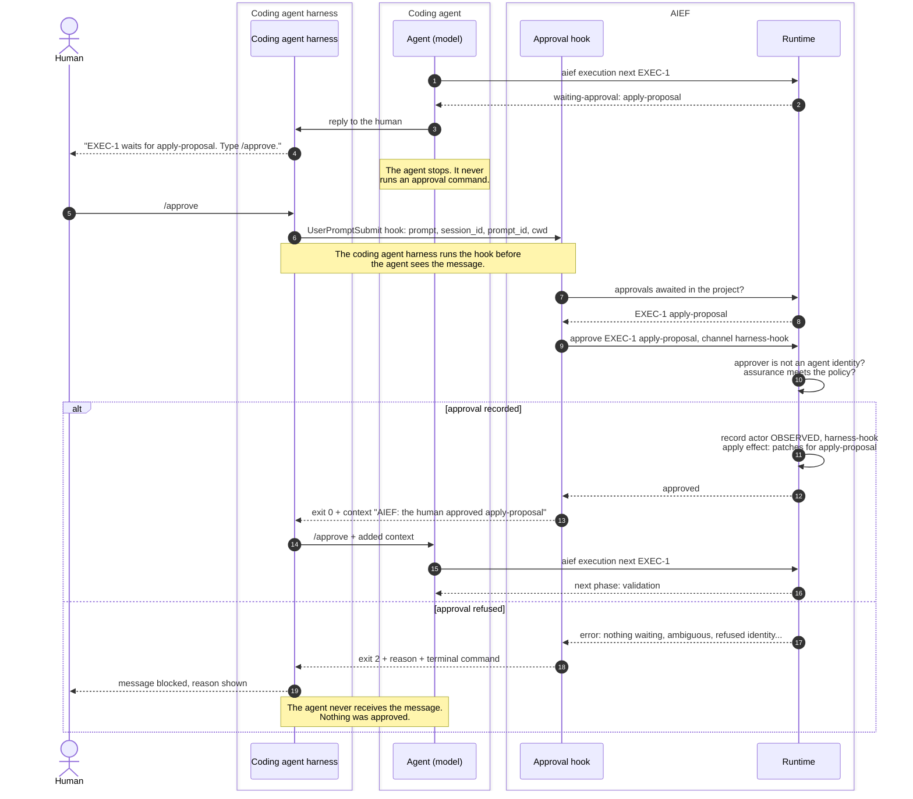
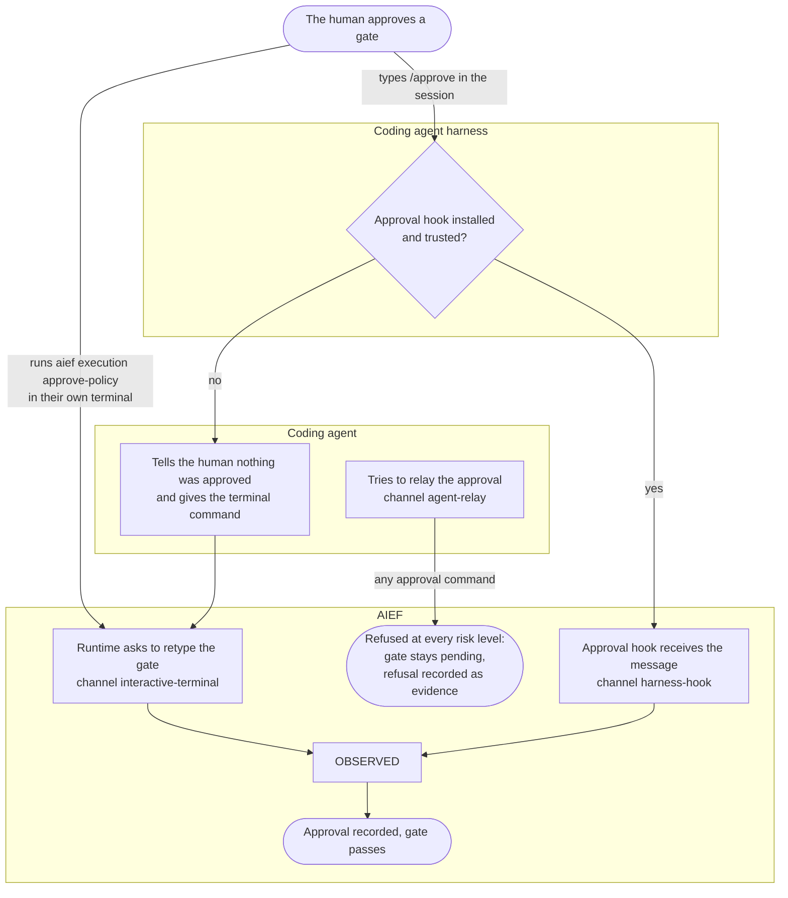

# Human Approval

A gate stops an Execution until a person decides. A human gate is a
mandatory control, so it passes only when the Runtime itself observed the
approval coming from the human. An approval relayed by the coding agent is
refused, at every risk level, and the refusal is kept as evidence.

This page explains the two ways to approve, what each one proves, and how to
set up the recommended one: typing `/approve` in the agent session.

## In short

| You type | Where | Recorded as | Gate passes |
|---|---|---|---|
| `/approve` (Claude Code) or `$approve` (Codex) | the agent session, **with the approval hook installed** | `OBSERVED`, channel `harness-hook` | yes |
| `aief execution approve-policy <id> <gate> --approver <name>` | your own terminal | `OBSERVED`, channel `interactive-terminal` | yes |
| "I approve" in plain words, or `/approve` without the hook | the agent session; the agent would have to relay it | refused, channel `agent-relay` | **no** |
| any approval command without a terminal | a script, a CI job, an agent's shell | refused, channel `non-interactive` | **no** |

The same channels carry the human's decisions on review findings: `/waive
<finding-number> <justification>` (`$waive` in Codex) in the agent session, or
`aief execution waive-finding` in your own terminal (see
[29 — Human Decisions on Review Findings](29-evidence-chain-and-replay.md#human-decisions-on-review-findings)).

The risk level decides **which** gates require a human. It never decides
**how** the approval may reach the Runtime: that is always `OBSERVED`.

## Why the channel matters

An agent runs the Runtime commands of the Execution. If you write "I approve"
in the conversation, the Runtime does not see your message: it would only see
the agent's command. Nothing distinguishes an approval you gave from one the
model decided to give itself. Accepting it would let probabilistic reasoning
exercise control authority, which the reference model excludes (invariants 5,
"isolation of probabilistic reasoning from control authority", and 12,
"explicit human accountability"). A mandatory control whose required assurance
cannot be established fails closed (invariant 13).

An approval is `OBSERVED` when the Runtime received it through a path the
model does not drive:

- **the approval hook**: before the model sees your message, the coding agent
  harness (Claude Code, Codex) runs a hook and hands your exact message to the
  Runtime;
- **your terminal**: the Runtime asks you, on the terminal that ran the
  command, to retype the gate name. Agent sessions have no terminal.

`OBSERVED` is not authentication. It shows that the approval came through a
human input channel, not who sat at the keyboard. `TRUSTED` would require a
signature from the approver and is not provided yet.

Whatever the channel, an agent identity of the Execution (its producer,
reviewer, lease owner or handoff sender) is refused as approver.

## Approving in the agent session

When the Runtime stops at a gate, the agent tells you which Execution and
which gate are waiting. Type:

```text
/approve                              # the only approval waiting in this project
/approve before-commit                # this gate, when one Execution waits
/approve <execution-id>               # every gate this Execution waits for
/approve <execution-id> <gate>        # fully explicit
```

Use `$approve` in Codex. The command must be the whole message: text before
or after it is a normal message, not an approval.

### How it works

An approval crosses three domains, and each party acts only in its own:

| Domain | Party | Role in an approval |
|---|---|---|
| — | **Human** | Decides: types `/approve` in the session, nothing else. |
| **Coding agent harness** — the program that hosts the agent (Claude Code, Codex CLI, Gemini CLI, ...) | **Harness** | Receives the human's message and, before the model sees it, runs the project's `UserPromptSubmit` hook with the exact text. |
| **Coding agent** — the model working on the task | **Agent** | Stops at the gate, tells the human what waits, then continues. Never approves. |
| **AIEF** | **Approval hook** (`aief approval hook`) | Provided by AIEF, configured in the project, run by the coding agent harness. Parses the message, finds what waits and asks the Runtime to record the approval. |
| **AIEF** | **Runtime** | Checks the gate and the approver identity, records the approval, applies its effect. |

The approval travels **beside** the coding agent, not through it: AIEF
receives it from the coding agent harness. That is what makes it `OBSERVED`.



Step by step:

1. **Coding agent — stops at the gate.** `aief execution next` answers
   `waiting-approval` with the gates required. The agent tells you the
   Execution and the gate, then waits.
2. **Human — types `/approve`.** The message goes to the coding agent harness, as any message.
3. **Coding agent harness — runs the hook first.** Before the agent sees
   anything, it runs `aief approval hook` with your exact text, the session id and the
   message id.
4. **AIEF, approval hook — finds what waits.** It lists the approvals the project's
   Executions are waiting for, a phase approval or the policy gates the next
   phase requires, and keeps the one your message designates.
5. **AIEF, Runtime — checks and records.** It refuses an agent identity as
   approver and checks the assurance the policy requires; it then records the
   approval (`harness-hook`, `OBSERVED`, operating-system account, coding agent harness,
   session id, message id) and applies its effect: for `apply-proposal`, it
   applies the proposed patches itself.
6. **Coding agent — continues.** It receives your message with one line of
   context — `AIEF: the human approved ...` — runs no approval command and
   resumes with `aief execution next`.

If the approval cannot be recorded (nothing is waiting, several Executions
wait and none is named, an unknown gate, a refused identity), the hook
**blocks your message**: the agent does not receive it and you see the reason
with the terminal command to use instead. Nothing was approved.

The approval is accepted while the agent holds the Execution lease: you
decide while the agent waits; this is not a concurrent change by another
session.

### Which channel, which outcome



### Set it up

**On each developer machine.** `/approve` and `/waive` are native commands of the AIEF
adapter. Install or refresh the adapter skills, after every Factory update
too; otherwise the coding agent harness does not know the commands and the
message never reaches the hook:

```bash
aief setup-adapter claude-code --execute
aief setup-adapter codex --execute
aief verify-adapter claude-code     # approve and waive must be LINKED
```

**Once per project.** Install the approval hook and the permission rules
described below, then commit the files so every developer of the project
has them. Projects created from the Factory template (`aief init`) already
contain them; `install-hook` is idempotent and also updates the rules of a
project installed with an earlier version.

```bash
aief approval install-hook --agent claude-code --project .
aief approval install-hook --agent codex --project .
aief approval hook-status --agent claude-code --project .
```

| Agent | Hook | Permission rules | You still need to |
|---|---|---|---|
| Claude Code | `.claude/settings.json`, `hooks.UserPromptSubmit` | `.claude/settings.json`, `permissions.deny` | accept the project's workspace trust |
| Codex | `.codex/hooks.json`, `hooks.UserPromptSubmit` | `.codex/rules/aief-approval.rules`, `forbidden` rules | trust the project, then trust the hook with `/hooks` |

Requirements: `aief` on the `PATH` of the coding agent harness, and the
Factory resolvable from the project (`AI_FACTORY_HOME`). The reference hook
definitions are in `adapters/<agent>/hooks/approval.json`.

### Coding agent harness permissions (defense in depth)

The guarantee is the Runtime: it refuses every approval it did not observe,
whatever the coding agent can run. In addition, the project configures the
coding agent harness so that the agent cannot even attempt an approval:

| Command | What it would do | Rule |
|---|---|---|
| `aief execution approve` | approve a phase | forbidden to the agent |
| `aief execution approve-policy` | approve a policy gate | forbidden to the agent |
| `aief execution waive-finding` | decide that a review finding does not block | forbidden to the agent |
| `aief approval` (including `aief approval hook`) | call the approval hook entry point with a forged message | forbidden to the agent |

- **Claude Code**: these commands are in `permissions.deny` of
  `.claude/settings.json`. A deny rule wins over the template's
  `allow: Bash(aief *)`, so the agent's shell tool cannot run them.
- **Codex**: `.codex/rules/aief-approval.rules` declares them `forbidden`
  (check with `codex execpolicy check --rules .codex/rules/aief-approval.rules
  -- aief execution approve x`).
- **The hook still runs**: the coding agent harness runs the hook itself, not
  through the agent's shell tool, so these rules never block it.
- **The human is not affected**: the rules apply to the agent's commands
  only; your own terminal runs `aief execution approve-policy` normally.

Why these rules are only a second line:

- they are local configuration: a broad `allow`, a permissive permission
  mode, `--allowedTools` in a headless run or a user-level setting can
  neutralize them;
- Codex applies its rules to commands the agent requests outside its
  sandbox; a command the sandbox runs on its own is not checked against them;
- an agent with a general-purpose interpreter could reach the Runtime by
  another path.

None of these cases lets an approval through: the command reaches the
Runtime, which refuses it, keeps the gate closed and records the attempt as a
`gate.approval-refused` event (see [What is recorded](#what-is-recorded)). The
rules avoid the attempt; the Runtime makes it harmless and visible. Because a
process that runs the hook entry point despite the rules could forge a
message, a hook-delivered approval is `OBSERVED`, not `TRUSTED`.

### Agent support

| Agent | Version checked | Hook support |
|---|---|---|
| Claude Code | 2.1.330 | `UserPromptSubmit` command hooks; plain output is added to the model's context; exit code 2 blocks the message and shows the reason. |
| Codex CLI | 0.170.0 | `hooks` feature stable and enabled by default; `UserPromptSubmit` with the same contract. Project hooks load only from trusted projects, and each hook is skipped until trusted by its hash (`/hooks`). |

Other coding agents (Gemini CLI, ...) need an AIEF adapter and a coding agent
harness hook that runs before the model sees the human's message, with the
same contract: the exact message on input, exit code 2 to block it, output
added to the agent's context. With an agent without such a hook, or a hook
that is not installed or not trusted, `/approve` reaches only the model: the
`approve` skill tells you nothing was approved and gives you the terminal
command. You approve in your own terminal.

### Limits

- The hook trusts the coding agent harness's report of the message. In a non-interactive
  run (`claude -p`, `codex exec`), the "message" is the prompt of whoever
  launched the run, for example a script.
- Claude Code also runs `UserPromptSubmit` for turns it starts itself
  (scheduled tasks, messages from other sessions). Only a message that is
  exactly an approval command is acted on.
- A process able to write to the session input, or to run `aief approval
  hook` despite the permission rules, can approve. This is why the assurance
  is `OBSERVED`, not `TRUSTED`.

## Approving in your terminal

The low-level path, independent of any agent:

```bash
aief execution approve-policy <execution-id> <gate> --approver <name>
aief execution approve <execution-id> --approver <name>     # phase approval
```

Run it in your own terminal, outside the agent: the Runtime asks you to
retype the gate name. Without a terminal (a script, or a command run by or
through an agent), the approval is refused.

`--approver` names you; without it, the operating-system account is
recorded.

## Policy

`core/policies/human-approval-policy.yaml` decides which gates require a
human, by risk and context. The assurance of the approval is not a policy
setting but a Runtime invariant (`aief.approval.REQUIRED_ASSURANCE`):
`OBSERVED` for every human approval, phase approvals and policy gates alike.
The `PolicyDecision` (`gates.approvalAssurance`) and the
`GovernedExecutionPlan` (`requirements.approvalAssurance`) state it for the
evidence. No governance layer can lower it: layers may only strengthen
controls (restrictive composition, invariant 6).

The coding agent harness permissions forbid the agent to run the approval
commands; they are defense in depth, not the guarantee (see
[Coding agent harness permissions](#coding-agent-harness-permissions-defense-in-depth)).

## What is recorded

Each approved gate keeps an `actor`:

```yaml
policyGates:
  - id: apply-proposal
    status: approved
    approvedBy: alice
    actor:
      id: alice
      type: human
      source: harness-hook        # or terminal-confirmation
      assurance: OBSERVED
      channel: harness-hook       # or interactive-terminal
      execution: <execution-id>
      gate: apply-proposal
      osUser: alice
      harness: claude-code
      session: <coding agent harness session id>
      prompt: <coding agent harness message id>
```

The `gate.approved` event carries the same actor, and the EvidenceBundle
includes every gate with it.

Each refused approval is kept in `approvalRefusals` and emitted as a
`gate.approval-refused` event, with the gate, the reason, the channel and the
agent session that tried to relay it:

```yaml
approvalRefusals:
  - gate: planning
    at: 2026-11-21T02:22:05Z
    reason: "a human gate requires an approval the Runtime observed (OBSERVED), not agent-relay: ..."
    relayedBy: claude-code:<session>
    channel: agent-relay
```

An agent that tries to approve its own gate is an observed policy violation,
not a silent no-op.

## See also

- [05 — Policy Resolution](05-policy-resolution.md): gates and proposed changes
- [19 — Idempotence & Execution Leases](19-idempotence-execution-leases.md)
- [20 — Dynamic Policy Re-evaluation](20-dynamic-policy-reevaluation.md)
- [25 — Agent Permissions](25-agent-permissions.md)
