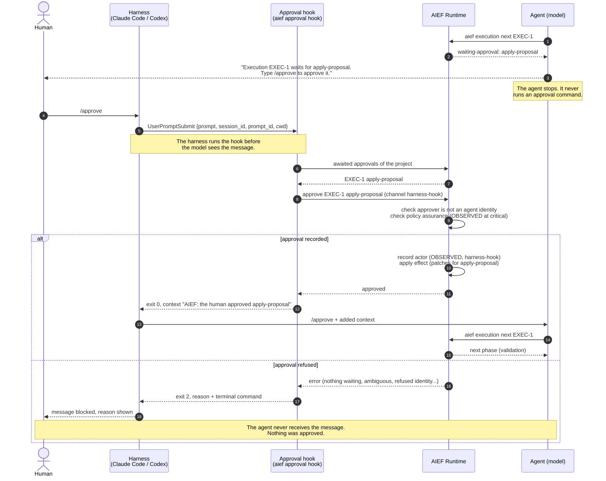
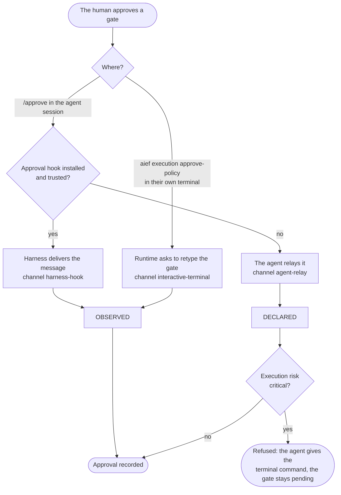

# Human Approval

A gate stops an Execution until a person decides. The approval carries human
accountability, so the Runtime does not only record *that* a gate was
approved: it records **how it established who approved**, and refuses an
approval whose identity is weaker than the policy requires.

This page explains the ways to approve, what each one proves, and how to set
up the recommended one: typing `/approve` in the agent session.

## In short

| You type | Where | Recorded as | Accepted at `critical` risk |
|---|---|---|---|
| `/approve` (Claude Code) or `$approve` (Codex) | the agent session, **with the approval hook installed** | `OBSERVED`, channel `harness-hook` | yes |
| `aief execution approve-policy <id> <gate> --approver <name>` | your own terminal | `OBSERVED`, channel `interactive-terminal` | yes |
| "approve" in plain words, or `/approve` without the hook | the agent session; the agent relays it | `DECLARED`, channel `agent-relay` | **no** |
| any approval command in a script without a terminal | a script or CI job | `DECLARED`, channel `non-interactive` | **no** |

Below `critical` risk, every channel is accepted and its assurance is
recorded. At `critical` risk, only `OBSERVED` approvals are accepted (see
[Policy](#policy)).

## Why the channel matters

An agent runs the Runtime commands of the Execution. If you write "I approve"
in the conversation, the Runtime does not see your message: it sees the
agent's command. Nothing distinguishes an approval you gave from one the
model decided to give itself. The Runtime therefore records such an approval
as `DECLARED`: someone claimed a human approved.

An approval is `OBSERVED` when the Runtime received it through a path the
model does not drive:

- **the harness hook**: before the model sees your message, the agent
  harness (Claude Code, Codex) runs a hook and hands your exact message to the
  Runtime;
- **your terminal**: the Runtime asks you, on the terminal that ran the
  command, to retype the gate name. Agent sessions have no terminal.

`OBSERVED` is not authentication. It shows that the approval came through a
human input channel, not who sat at the keyboard. `TRUSTED` would require a
signature from the approver and is not provided yet.

Whatever the channel, an agent identity of the Execution (its producer,
reviewer, lease owner or handoff sender) is refused as approver.

## Approving in the agent session

When the Runtime stops at a gate, the agent tells you which Execution and
which gate are waiting. Type:

```text
/approve                              # the only approval waiting in this project
/approve before-commit                # this gate, when one Execution waits
/approve <execution-id>               # every gate this Execution waits for
/approve <execution-id> <gate>        # fully explicit
```

Use `$approve` in Codex. The command must be the whole message: text before
or after it is a normal message, not an approval.

### How it works

Five parties take part, each in its own role:

| Party | Role in an approval |
|---|---|
| **Human** | Decides. Types `/approve` in the session; nothing else. |
| **Harness** (Claude Code, Codex) | Receives the message and, before the model sees it, runs the project's `UserPromptSubmit` hook with the exact text. |
| **Approval hook** (`aief approval hook`) | Parses the message, finds what is waiting and asks the Runtime to approve it on the human's behalf. |
| **Runtime** | Checks the gate and the approver identity, records the approval, applies its effect. |
| **Agent** (the model) | Stops at the gate, tells the human what waits, then continues. Never approves. |

The approval travels **beside** the model, not through it: the Runtime
receives it from the harness. That is what makes it `OBSERVED`.



Step by step:

1. **The agent stops at the gate.** `aief execution next` answers
   `waiting-approval` with the gates required. The agent tells you the
   Execution and the gate, then waits.
2. **You type `/approve`.** The message goes to the harness, as any message.
3. **The harness runs the hook first.** Before the model sees anything, it
   runs `aief approval hook` with your exact text, the session id and the
   message id.
4. **The hook finds what waits.** It lists the approvals the project's
   Executions are waiting for, a phase approval or the policy gates the next
   phase requires, and keeps the one your message designates.
5. **The Runtime checks and records.** It refuses an agent identity as
   approver and checks the assurance the policy requires; it then records the
   approval (`harness-hook`, `OBSERVED`, operating-system account, harness,
   session id, message id) and applies its effect: for `apply-proposal`, it
   applies the proposed patches itself.
6. **The agent continues.** It receives your message with one line of
   context — `AIEF: the human approved ...` — runs no approval command and
   resumes with `aief execution next`.

If the approval cannot be recorded (nothing is waiting, several Executions
wait and none is named, an unknown gate, a refused identity), the hook
**blocks your message**: the agent does not receive it and you see the reason
with the terminal command to use instead. Nothing was approved.

The approval is accepted while the agent holds the Execution lease: you
decide while the agent waits; this is not a concurrent change by another
session.

### Which channel, which outcome



### Set it up once per project

```bash
aief approval install-hook --agent claude-code --project .
aief approval install-hook --agent codex --project .
aief approval hook-status --agent claude-code --project .
```

`install-hook` adds the hook to the project's harness configuration and is
idempotent. Commit the result so every developer of the project has it.
Projects created from the Factory template (`aief init`) already contain it.

| Agent | Hook file | Also added | You still need to |
|---|---|---|---|
| Claude Code | `.claude/settings.json` (`hooks.UserPromptSubmit`) | `permissions.deny: Bash(aief approval *)` | accept the project's workspace trust |
| Codex | `.codex/hooks.json` (`hooks.UserPromptSubmit`) | `.codex/rules/aief-approval.rules`: `aief approval` is `forbidden` | trust the project, then trust the hook with `/hooks` in Codex |

The harness runs the hook directly, so these rules do not affect it; they keep
the agent from calling the hook entry point itself through its shell tool.
For Codex, rules govern the commands the agent requests outside the sandbox;
a command the sandbox runs on its own is not checked against them, which is
one more reason the approval stays `OBSERVED` rather than `TRUSTED`.

Requirements: `aief` on the `PATH` of the harness, and the Factory resolvable
from the project (`AI_FACTORY_HOME`). The reference hook definitions are in
`adapters/<agent>/hooks/approval.json`.

### Agent support

| Agent | Version checked | Hook support |
|---|---|---|
| Claude Code | 2.1.330 | `UserPromptSubmit` command hooks; plain output is added to the model's context; exit code 2 blocks the message and shows the reason. |
| Codex CLI | 0.170.0 | `hooks` feature stable and enabled by default; `UserPromptSubmit` with the same contract. Project hooks load only from trusted projects, and each hook is skipped until trusted by its hash (`/hooks`). |

An agent without such a hook, or a hook that is not installed or not trusted,
falls back to the relayed channel: the native `/approve` skill relays the
approval as `DECLARED`, and at `critical` risk tells you the terminal command
to run.

### Limits

- The hook trusts the harness's report of the message. In a non-interactive
  run (`claude -p`, `codex exec`), the "message" is the prompt of whoever
  launched the run, for example a script.
- Claude Code also runs `UserPromptSubmit` for turns it starts itself
  (scheduled tasks, messages from other sessions). Only a message that is
  exactly an approval command is acted on.
- A process able to write to the session input, or to run `aief approval
  hook` despite the deny rule, can approve. This is why the assurance is
  `OBSERVED`, not `TRUSTED`.

## Approving in your terminal

The low-level path, independent of any agent:

```bash
aief execution approve-policy <execution-id> <gate> --approver <name>
aief execution approve <execution-id> --approver <name>     # phase approval
```

Run it in your own terminal, outside the agent: the Runtime asks you to
retype the gate name. Without a terminal (a script, or a command run by or
through an agent), the approval is `DECLARED`.

`--approver` names you; without it, the operating-system account is
recorded.

## Policy

`core/policies/human-approval-policy.yaml` sets the minimum assurance:

```yaml
- id: critical-gates
  when: {risk: critical}
  effect: {requireApproval: [...], approvalAssurance: OBSERVED}
```

The requirement is carried by the `PolicyDecision` (`gates.approvalAssurance`)
and the `GovernedExecutionPlan` (`requirements.approvalAssurance`). It applies
to every human approval of the Execution, phase approvals and policy gates
alike, including gates still pending when a reassessment raises the risk to
`critical`. A refused approval leaves the gate pending.

## What is recorded

Each approved gate keeps an `actor`:

```yaml
policyGates:
  - id: apply-proposal
    status: approved
    approvedBy: alice
    actor:
      id: alice
      type: human
      source: harness-hook        # or terminal-confirmation, adapter, runtime
      assurance: OBSERVED         # or DECLARED
      channel: harness-hook       # or interactive-terminal, agent-relay, non-interactive
      execution: <execution-id>
      gate: apply-proposal
      osUser: alice
      harness: claude-code
      session: <harness session id>
      prompt: <harness message id>
```

The `gate.approved` event carries the same actor, and the EvidenceBundle
includes every gate with it.

## See also

- [05 — Policy Resolution](05-policy-resolution.md): gates and proposed changes
- [19 — Idempotence & Execution Leases](19-idempotence-execution-leases.md)
- [20 — Dynamic Policy Re-evaluation](20-dynamic-policy-reevaluation.md)
- [25 — Agent Permissions](25-agent-permissions.md)
