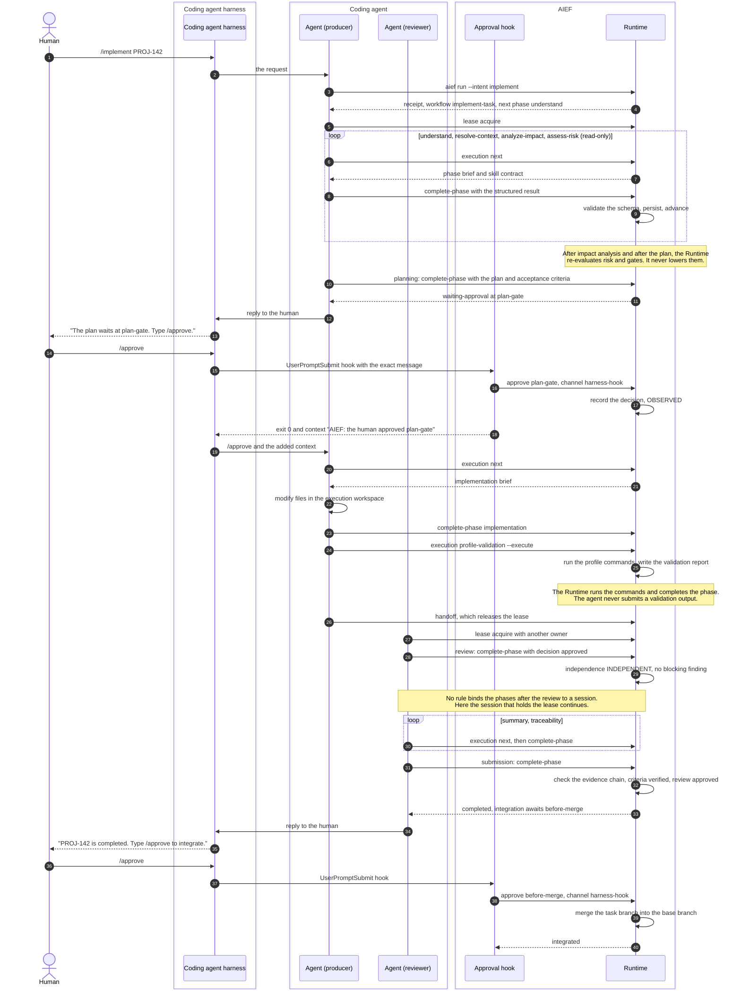
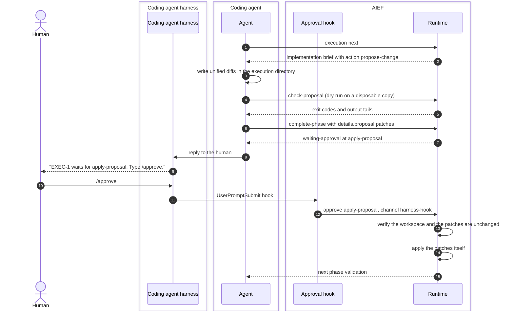
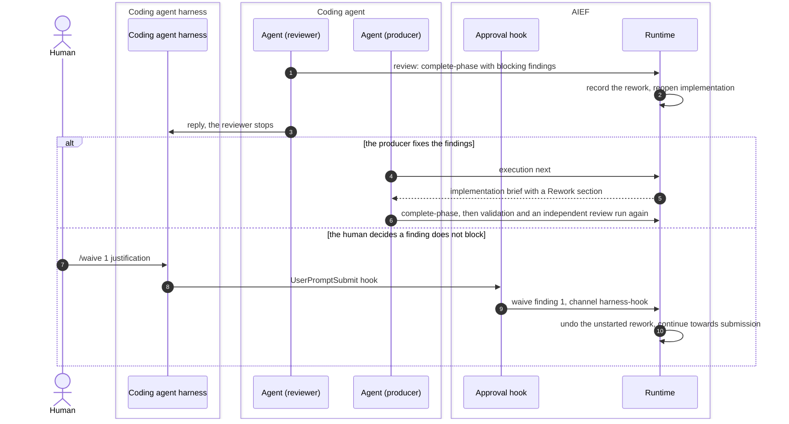
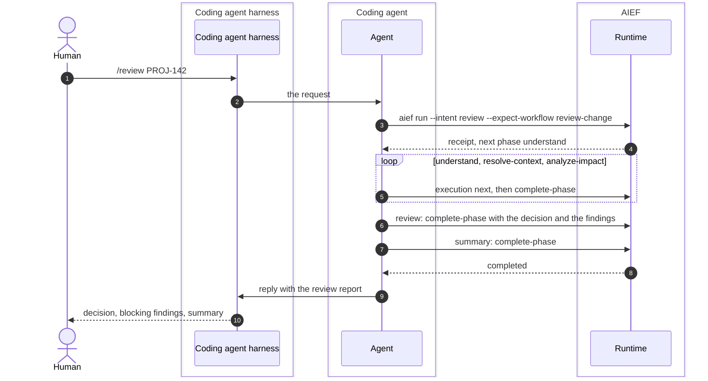
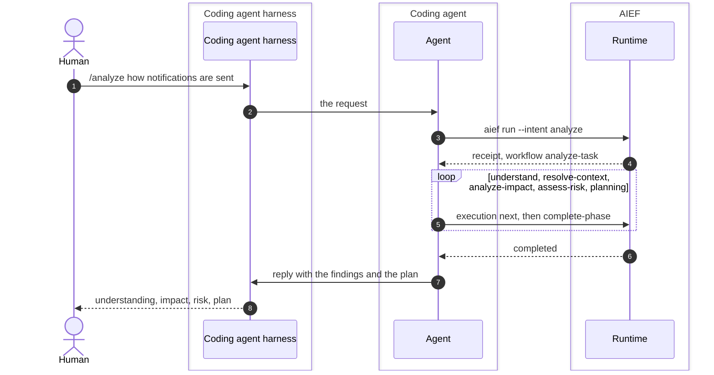

# Workflow Execution Processes

Each base action (`/implement`, `/fix`, `/refactor`, `/test`, `/review`,
`/analyze`, `/document`, `/promote`) starts one Workflow. This page gives the
nominal execution of each: its phases, who acts in each one, where a human
decides, and how it ends.

It describes the nominal case: no failure, no refused approval, no review that
requests changes. The deviations that matter are drawn separately
([A proposal below L2](#variant-a-proposal-below-l2),
[A review that requests changes](#variant-a-review-that-requests-changes)).

## In short

| Action | Codex | Workflow | Phases | Ends with |
|---|---|---|---|---|
| `/implement` | `$implement` | `implement-task` | understand, resolve-context, analyze-impact, assess-risk, **planning** (`plan-gate`), implementation, validation, review, summary, traceability, **submission** (`submission-gate`) | a change request, then the integration if the policy requires `before-merge` |
| `/fix` | `$fix` | `fix-bug` | as `implement-task`, without `plan-gate` and without summary | a change request |
| `/refactor` | `$refactor` | `refactor-code` | understand, resolve-context, analyze-impact, assess-risk, planning, implementation, validation, review, summary | the reviewed change and its summary |
| `/test` | `$test` | `add-tests` | understand, resolve-context, analyze-impact, planning, implementation, validation, review | the reviewed tests |
| `/document` | `$document` | `update-documentation` | understand, resolve-context, analyze-impact, implementation, review, traceability | the reviewed documentation change and its traceability |
| `/review` | `$review` | `review-change` | understand, resolve-context, analyze-impact, review, summary | a review report, an impact analysis and a summary |
| `/analyze` | `$analyze` | `analyze-task` | understand, resolve-context, analyze-impact, assess-risk, planning | an understanding, an impact analysis, a risk assessment and a plan |
| `/promote` | `$promote` | `promote-knowledge` | evaluate, **record** (`knowledge-promotion-gate`) | recorded project knowledge |

The phases are defined in `core/workflows/<workflow>/workflow.yaml`. Policy
gates (`before-implementation`, `apply-proposal`, `before-commit`,
`before-submission`, `before-merge`) come on top of the phase gates in the
table; the risk decides which ones apply (see [Gates](#gates-by-risk)).

## The loop every action shares

Whatever the action, an Execution moves through the same loop. Only the phases
and the gates differ.

1. The agent normalizes the request and calls `aief run` with the intent and
   the workflow the native command expects. The Runtime answers with a receipt
   (execution, intent, workflow, next phase).
2. The agent acquires the Execution lease with its own owner.
3. For each phase, the agent calls `aief execution next`, reads the **phase
   brief** and the skill contract, does the work the skill allows, and submits
   the structured result with `aief execution complete-phase`. The Runtime
   validates it against the skill's output schema, persists it and advances.
4. The agent stops as soon as the Runtime answers `waiting-approval`,
   `blocked`, `failed`, `cancelled` or `completed`.

A skill has a mode: `read-only` (understand, resolve-context, analyze-impact,
assess-risk, plan, summary), `change` (implementation), `validation`
(validation, review) or `external-action` (traceability, submission). The mode
bounds what the agent may do in the phase. Progress is never read from the
conversation: a new session, or another agent, resumes from the persisted state
(see [19 — Idempotence & Execution Leases](19-idempotence-execution-leases.md)).

## Implement

The reference process. The other actions are described by what they remove or
change.

The example is a task `PROJ-142` of medium risk, run at autonomy **L3**: the
agent modifies files in the execution workspace and may submit the change (see
[Autonomy](#autonomy)). A project created from the Factory template starts at
L1 and follows [the proposal variant](#variant-a-proposal-below-l2) instead.
The diagram separates the three domains: the **coding agent harness** that
hosts the agent, the **coding agent** (the model) and **AIEF**.

What each step relies on:

| Phase | Mode | Who does the work | Artifact |
|---|---|---|---|
| understand, resolve-context, analyze-impact, assess-risk | read-only | the agent reads; the Runtime loads the context (see [21](21-effective-engineering-context.md)) and calculates the policy decision | task understanding, impact analysis, risk assessment |
| planning | read-only | the agent writes the plan and its acceptance criteria; the human decides at `plan-gate` | implementation plan |
| implementation | change | the agent modifies the execution workspace | changes |
| validation | validation | the Runtime runs the validation commands of the profiles and records the evidence | validation report |
| review | validation | another session reviews, after the producer's handoff; independence compares the producer of the implementation with the reviewer of the review | review report |
| summary | read-only | the session that holds the lease | change summary |
| traceability | external-action | the session that holds the lease records the chain from task to review; with a local task tracking, it only writes `.ai/runtime` | traceability |
| submission | external-action | the session that holds the lease submits; the Runtime refuses unless the evidence chain is complete | change request |
| integration | — | the human approves `before-merge`; the Runtime merges | the merge |

A human gate is passed only by a decision the Runtime observed: see
[34 — Human Approval](34-human-approval.md). `aief execution pending` lists
what waits for you and the commands to use.

### Autonomy

The autonomy decides what the agent may do (`core/policies/autonomy-policy.yaml`).
The effective autonomy is the lowest of the one requested and the cap of the
effective risk:

| Level | Actions allowed |
|---|---|
| L0 | read, inspect, search, explain |
| L1 | analyze, plan and **propose-change** |
| L2 | **modify-local-files**, run-validation, review |
| L3 | commit, push, **submit-change**, create, link and update tasks |
| L4 | merge-authorized-intermediate |

| Risk | Maximum autonomy |
|---|---|
| critical | L1 |
| high | L2 |
| medium | L3 |
| low | L4 |

Three consequences for the processes below:

- the project template sets `autonomy.default: L1`: unless a project raises it,
  an implementation follows the proposal variant;
- a critical change always follows it, whatever the project asks;
- `submit-change` is allowed from L3: at high risk, capped at L2, the policy
  denies it. The Runtime does not check that denial when the `submission`
  phase completes: it checks the required enforcement points and the evidence
  chain. What stands between the agent and an unwanted submission is the human
  gates the policy requires (`before-commit`, `before-submission` and
  `before-merge` at high risk) and the permissions of the coding agent harness
  ([34 — Human Approval](34-human-approval.md#coding-agent-harness-permissions-defense-in-depth)).

### Gates by risk

The plan gate and the submission gate belong to the workflow. The policy gates
depend on the effective risk (`core/policies/human-approval-policy.yaml`):

| Risk | Policy gates that require a human |
|---|---|
| low | none |
| medium | `before-merge` |
| high | `before-commit`, `before-submission`, `before-merge` |
| critical | `before-implementation`, `before-commit`, `before-submission`, `before-merge` |

A target branch declared protected requires `before-merge` at any risk. The
risk can rise during the Execution, after the impact analysis or the plan; it
never goes down ([20 — Dynamic Policy Re-evaluation](20-dynamic-policy-reevaluation.md)).

### Variant: a proposal below L2

When the effective autonomy denies `modify-local-files` but allows
`propose-change` (L1), the agent never touches the workspace. This is the
default of a project created from the template, and the only mode of a
critical change. It writes its
change as patches, and a human applies them through a gate
([05 — Proposed changes](05-policy-resolution.md#proposed-changes)).

### Variant: a review that requests changes

A review that does not approve the change, or that holds a blocking finding,
ends the pass. The Runtime reopens the implementation instead of advancing
([29 — Review Outcome and Rework](29-evidence-chain-and-replay.md#review-outcome-and-rework)).

Reworks are bounded. When the limit is reached, the Execution is `blocked` and
the human decides the remaining findings with `/waive`, or cancels.

## Fix

`fix-bug` runs the `implement-task` sequence with two differences:

- no `plan-gate`: the planning phase does not wait for the human, unless the
  policy decision adds a gate;
- no summary phase: the process goes from review to traceability and submission.

The agent still reproduces and analyzes in the read-only phases, modifies the
workspace in implementation, and the Runtime still validates and integrates
under the same gates. The review, its independence and its rework loop are
identical.

## Refactor

`refactor-code` stops after the summary. There is no traceability and no
submission: the result is the reviewed change and its summary, which the human
integrates through `before-merge` when the policy requires it. The behavior
preserved by a refactoring is what the validation phase checks: the Runtime runs
the same profile commands as for an implementation.

## Test

`add-tests` has no risk assessment, no summary, no traceability and no
submission: understand, resolve-context, analyze-impact, planning,
implementation, validation, review. The implementation phase writes tests; the
Runtime runs the profile commands and an independent review follows.

## Document

`update-documentation` has no planning phase and no validation phase:
understand, resolve-context, analyze-impact, implementation, review,
traceability. The implementation phase edits the documentation; the review is
independent as for a code change.

## Review

`review-change` never modifies anything. Its `review` phase examines an existing
change (a merge request, a branch, a diff) and produces the review report.

## Analyze

`analyze-task` produces understanding, impact analysis, risk assessment and a
plan, and changes nothing. It is the way to know what a task involves before
deciding to implement it. The Execution ends after the planning phase: there
is no change to validate, submit or integrate.

## Promote

`promote-knowledge` does not change code: it moves a candidate from task memory
to durable project knowledge, which the whole project then loads
([06 — Context & Knowledge Lifecycle](06-context-and-memory.md)). Two phases:

| Phase | What happens |
|---|---|
| `evaluate` | read-only: the agent identifies reusable knowledge in the task evidence and proposes a promotion without writing anything durable |
| `record` | behind `knowledge-promotion-gate`, the human approves the candidate, the target and the exact durable statement; the knowledge is then recorded in the project |

The gate follows the rules of [34 — Human Approval](34-human-approval.md): the
approval must be observed by the Runtime.

## What stops an Execution

| Runtime answer | Meaning | What you do |
|---|---|---|
| `waiting-approval` | a gate waits for a human decision | `/approve` or `/revise` it, or reject it in your terminal; `aief execution pending` lists them |
| `blocked` | a question, an exhausted rework, an unsafe workspace, a required tracking | read the reason with `aief execution inspect`, answer or decide |
| `failed` | a phase failed beyond its recovery budget | read the evidence, start a new Execution |
| `cancelled` | a human rejection, a cancellation or an expired gate | none |
| `completed` | every phase is done; the integration may wait for `before-merge` | approve the integration |

## See also

- [11 — Task Lifecycle](11-lifecycle.md): the lifecycle every Workflow instantiates
- [14 — Universal Runtime](14-universal-runtime.md): requests, intents and the commands
- [19 — Idempotence & Execution Leases](19-idempotence-execution-leases.md): leases and handoff
- [29 — Evidence Chain & Validation Replay](29-evidence-chain-and-replay.md): independent review, rework and evidence
- [34 — Human Approval](34-human-approval.md): approving, rejecting and revising at a gate
